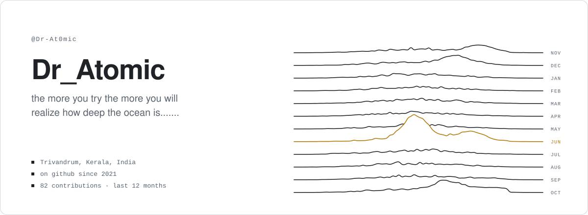
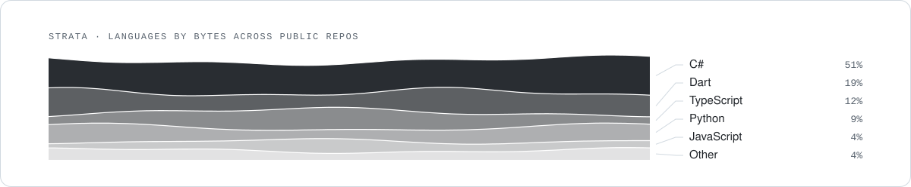

<picture>
  <source media="(prefers-color-scheme: dark)" srcset="./assets/pulsar-header-dark.svg">
  
</picture>

**Dr_Atomic** — the more you try the more you will realize how deep the ocean is.......

I build software end to end — the database, the APIs, the web and mobile UI, the ML models and the deployment. Mostly that means multi-tenant SaaS that stays fast, secure and properly isolated, and AI features that cite their sources instead of making things up.

**Now** — README Templates

[dr-at0mic.github.io](https://dr-at0mic.github.io/) &nbsp;·&nbsp; [anandhu2suresh797@gmail.com](mailto:anandhu2suresh797@gmail.com) &nbsp;·&nbsp; [LinkedIn](https://www.linkedin.com/in/anandhu-suresh-9908ab19a/)

#### Selected work

- **[og-converter](https://github.com/Dr-At0mic/og-converter)** — The zero-click offline file converter for Windows (inspired by Tangerine for Mac).  
  C# · ★ 22
- **[Breathe](https://github.com/Dr-At0mic/Breathe)**  
  Dart · ★ 2
- **[Dr-At0mic.github.io](https://github.com/Dr-At0mic/Dr-At0mic.github.io)**  
  JavaScript

#### Stack

<picture>
  <source media="(prefers-color-scheme: dark)" srcset="./assets/pulsar-strata-dark.svg">
  
</picture>

Colophon

The header is a ridgeline in the manner of the PSR B1919+21 pulsar plot: each line is one month, its shape traced from that month's daily contributions; the brightest line is the busiest month. Strata show language share by bytes across public repositories. Static SVG, generated by README Templates · template: Pulsar.

