<picture>
  <source media="(prefers-color-scheme: dark)" srcset="./assets/shonen-title-dark.svg">
  
</picture>

<b>Dr_Atomic</b> — the more you try the more you will realize how deep the ocean is.......

<a href="https://dr-at0mic.github.io/">dr-at0mic.github.io</a> &nbsp;·&nbsp; <a href="mailto:anandhu2suresh797@gmail.com">anandhu2suresh797@gmail.com</a> &nbsp;·&nbsp; <a href="https://www.linkedin.com/in/anandhu-suresh-9908ab19a/">LinkedIn</a>

**Previously on @Dr-At0mic…** I craft digital realms from the ground up—from deep database dungeons and API ley lines to pixel-perfect UIs and neural algorithms. I summon multi-tenant SaaS architectures built for unstoppable speed, ironclad security, and absolute domain isolation. My AI summons don't hallucinate; they state their facts straight from the scrolls. No filler, just pure code execution.

**Next episode:** README Templates

#### Character sheet

<picture>
  <source media="(prefers-color-scheme: dark)" srcset="./assets/shonen-sheet-dark.svg">
  
</picture>

How these stats are computed

- **STR** — Contributions, last 12 months: 86
- **AGI** — Active days: 21
- **END** — Longest streak (days): 4
- **INT** — Languages wielded: 6
- **CHA** — Stars earned: 24
- **Rank** — average of the five bars (S ≥ 85%, A ≥ 70%, B ≥ 50%, C ≥ 30%).
- **Power level** — contributions×9 + stars×21 + followers×13 + active days×7 + longest streak×42. Scientifically meaningless. Spiritually accurate.

Artwork: original animated SVG, generated by README Templates · template: Shōnen. Motion stops if your system asks for reduced motion.

#### Story arcs

- **Arc 1 · [og-converter](https://github.com/Dr-At0mic/og-converter)** — The zero-click offline file converter for Windows (inspired by Tangerine for Mac).  
  C# · ★ 22
- **Arc 2 · [Breathe](https://github.com/Dr-At0mic/Breathe)**  
  Dart · ★ 2
- **Arc 3 · [Dr-At0mic.github.io](https://github.com/Dr-At0mic/Dr-At0mic.github.io)**  
  JavaScript

<picture>
  <source media="(prefers-color-scheme: dark)" srcset="./assets/shonen-end-dark.svg">
  
</picture>

