<picture>
  <source media="(prefers-color-scheme: dark)" srcset="./assets/singularity-hero-dark.svg">
  
</picture>

<b>Dr_Atomic</b> · Full-stack software engineer. I build multi-tenant SaaS, secure APIs, and practical AI from database to phone.

<a href="https://dr-at0mic.github.io/">dr-at0mic.github.io</a> &nbsp;·&nbsp; <a href="mailto:anandhu2suresh797@gmail.com">anandhu2suresh797@gmail.com</a> &nbsp;·&nbsp; <a href="https://www.linkedin.com/in/anandhu-suresh-9908ab19a/">LinkedIn</a>

> **Mission brief.** I build software end to end  the database, the APIs, the web and mobile UI, the ML models, and the AWS setup they run on (down to the monthly bill). Mostly that means architecting multi-tenant SaaS across NestJS, FastAPI, PostgreSQL, Flutter, and React that stays fast and properly isolated, alongside PyTorch models trained from scratch and RAG pipelines that cite their sources instead of making things up. I think about failure modes first, and I quite enjoy the hard migrations nobody else wants.
>
> **Current objective.** BC with work.

#### Telemetry

<picture>
  <source media="(prefers-color-scheme: dark)" srcset="./assets/singularity-telemetry-dark.svg">
  
</picture>

Reading the instruments

- **Accretion disk:** one particle per day of the last year; brighter and closer to the hole means a busier day. Inner rings orbit faster, as they would around a real black hole.
- **Orbit:** contributions per month, plotted as a closed trajectory; the beacon marks the busiest month.
- **Spectral composition:** language share by bytes across public repositories.
- **Light theme:** rendered as a photographic negative, the way astronomical survey plates were printed.

Artwork: original animated SVG, generated by README Templates · template: Singularity. Motion stops if your system asks for reduced motion.

#### Flight log

- `MSN-01` **[og-converter](https://github.com/Dr-At0mic/og-converter)** · The zero-click offline file converter for Windows (inspired by Tangerine for Mac).  
  C# · ★ 26
- `MSN-02` **[README-Templates](https://github.com/Dr-At0mic/README-Templates)** · Design a GitHub profile README, preview it exactly as GitHub renders it (light and dark), and publish it to your `username/username` repo  
  JavaScript · ★ 5
- `MSN-03` **[Breathe](https://github.com/Dr-At0mic/Breathe)**  
  Dart · ★ 2
- `MSN-04` **[Dr-At0mic.github.io](https://github.com/Dr-At0mic/Dr-At0mic.github.io)**  
  JavaScript

<picture>
  <source media="(prefers-color-scheme: dark)" srcset="./assets/singularity-end-dark.svg">
  
</picture>

